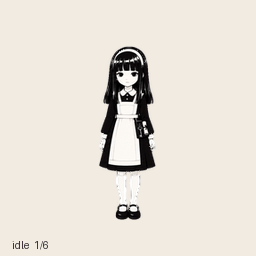
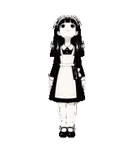

# Suey pet, iteration v2

This is the validated artwork used to create and select Suey as a custom ChatGPT Work pet on 2026-10-26. The character keeps an impassive face in every animation. State changes are conveyed by body gestures and head direction. Keep her straight black hair, white headband, black dress and ivory apron, fixed-side hip bag, silver decoy key, and ivory scroll. No cape.




## Contents

- `Suey-v2.png`: final transparent atlas, 1536 x 2288 pixels, eight columns and eleven rows, with 192 x 208 cells.
- `previews/`: individual state GIFs, all-state GIF/MP4, idle-to-jump-to-idle transition, look loop, and labeled stills.
- `contact-sheet.png` and `look-directions.png`: labeled visual inspection sheets.
- `source/`: accepted generated strips, character references, generation prompts, request manifests, and QA reports. The original row-10 image is retained alongside its shared-scale correction; the final PNG at the package root is authoritative. Creation-machine paths are replaced with placeholders.
- `qa/`: final structural, transparency, direction, continuity, and independent visual reports. These describe the creation run; paths containing placeholders are historical provenance.
- `pet-record.json`: durable ChatGPT pet ID and creation-time selection verification. Active selection can change later and is not synchronized with this repository.
- `manifest.json`: file sizes and SHA-256 hashes. The validated atlas SHA-256 is `5503d78ee4adf561f0c5449b51a747403830e3003cc71462d9642c4cd2183fe5`.
- `export_frames.py`: portable Pillow-based exporter that reads only the final atlas. It does not run sensors or send alerts.

## Export for the desktop sprite

Install Pillow in your Python environment, then run from the repository root:

```powershell
python -m pip install Pillow
python chatgpt-pet/v2/export_frames.py --output exported-suey-frames
```

The exporter verifies the atlas hash and writes 73 transparent PNG frames: 57 standard animation frames plus sixteen look frames. It refuses to overwrite existing target frames. The original PyQt sprite expects other GIF names; adapting its loader and event mapping is a future change.

## Atlas layout

Rows and frames are zero-indexed. Unused cells are transparent.

| Row | State | Frames |
| --- | --- | --- |
| 0 | idle | 6 |
| 1 | running-right | 8 |
| 2 | running-left | 8 |
| 3 | waving | 4 |
| 4 | jumping | 5 |
| 5 | failed | 8 |
| 6 | waiting | 6 |
| 7 | running (active work gesture) | 6 |
| 8 | review | 6 |
| 9 | look 000 through 157.5 degrees | 8 |
| 10 | look 180 through 337.5 degrees | 8 |

Look directions are clockwise in viewer coordinates: 000 up, 090 right, 180 down, 270 left. Each intermediate step is 22.5 degrees. The torso stays anchored while the head aims; the facial expression stays blank.

## Bag of tricks and next iteration

The key represents the original decoy concept; the scroll represents cryptic verses. This native pet supports artwork and state reactions. It does not run the repository's watcher, clipboard, keyboard, honeypot, or Telegram code. Those integrations need their own implementation and validation. The existing honeypot prototype polls for new directory entries rather than detecting reads of existing files, and its keylogger-spike event is simulated.

All format, transparency, jump, registration and blind direction checks passed. Two diagonal pitch cues are subtle (112.5 and 202.5 degrees), and the skirt and hair tips spread slightly during jumping; these observations are retained in QA for future art refinements.

To revise the character, start with the canonical base and accepted strips in `source/`, preserve her face and prop side, regenerate affected coherent strips, rebuild the atlas, and repeat structural and motion checks before updating the existing pet ID. The source jobs were produced with the Work Pets plugin 0.1.6 and image generation; this package does not vendor that plugin or promise a one-command regeneration of the artwork.
